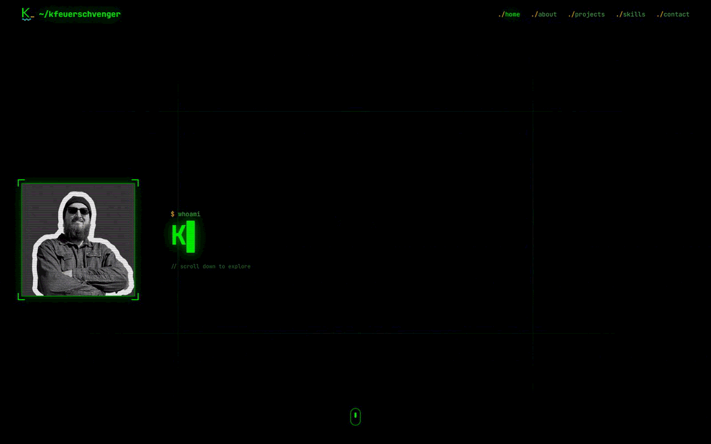
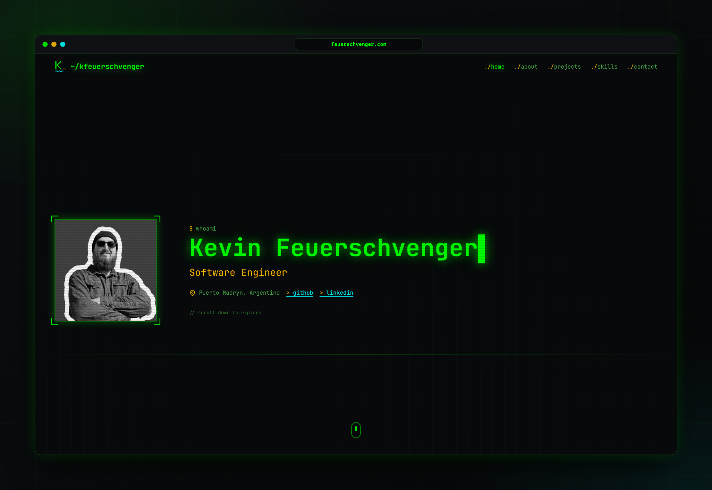
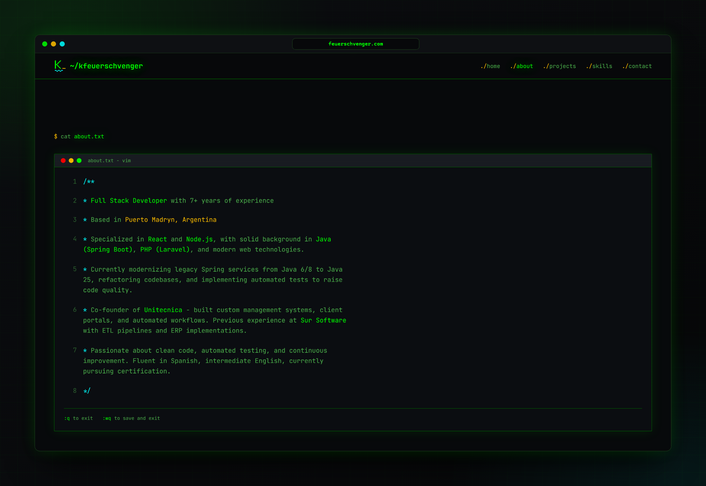
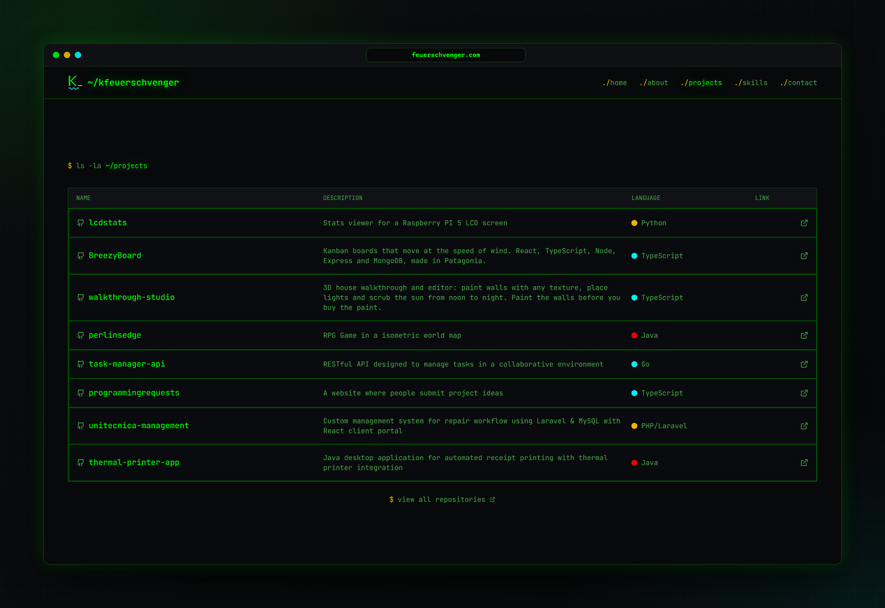
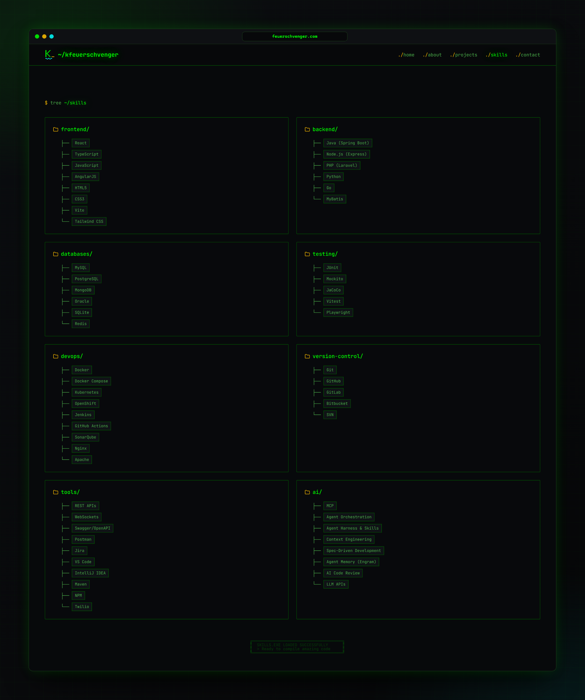
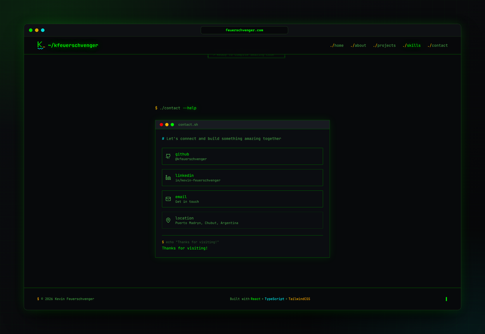
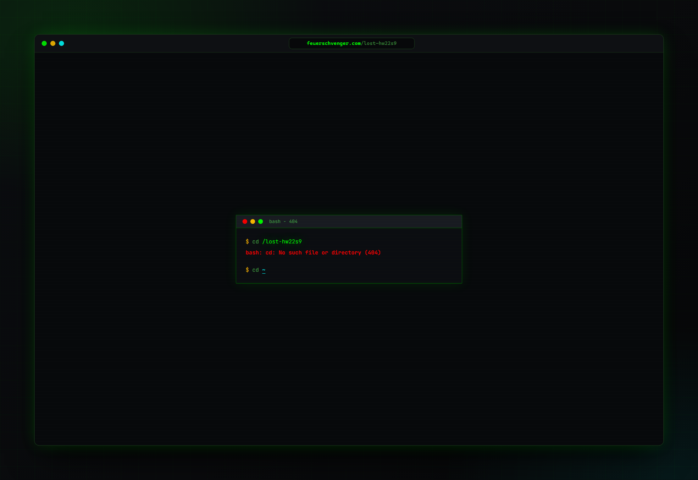
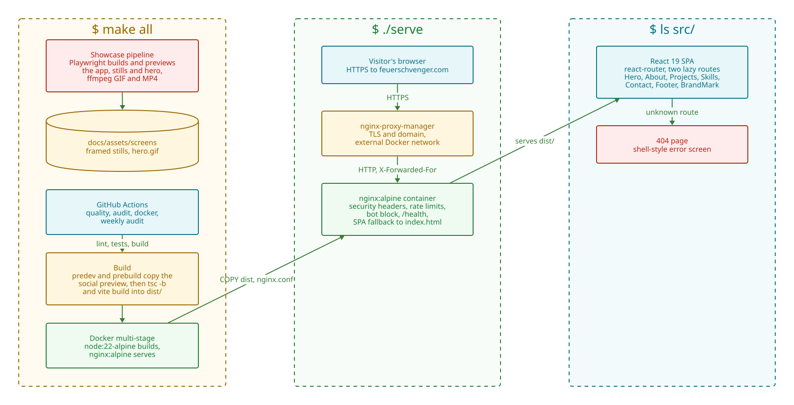

<p align="center">
  <picture>
    <source media="(prefers-color-scheme: dark)" srcset="docs/assets/brand/banner-dark.svg">
    
  </picture>
</p>

<p align="center">
  <a href="https://github.com/kfeuerschvenger/portfolio/actions/workflows/ci.yml"></a>
  <a href="LICENSE"></a>
  
  
  
  
</p>

<p align="center"><strong>English</strong> · <a href="README_es.md">Español</a></p>

<p align="center">
  
</p>

**A portfolio that boots like a terminal and exits with code 0.**

Hi, I am Kevin, a Software Engineer from Puerto Madryn, and this is my corner of the internet: a single page dressed as a shell session, complete with phosphor green, a block cursor and scanlines you can almost hear humming.

Every section is a command. `cat about.txt` opens a vim window, `ls -la ~/projects` lists my repositories and `tree ~/skills` unfolds the stack. No backend, no cookies, no `sudo` required.

Compiled near the whales, so it is a little calmer than your average build.

## $ ./tour

<table>
  <tr>
    <td width="50%" valign="top">
      
      <p><strong>$ whoami</strong> A name that types itself, a title that follows, and a photo that turns to colour when you point at it.</p>
    </td>
    <td width="50%" valign="top">
      
      <p><strong>$ cat about.txt</strong> Seven years of experience in a vim window. Try <code>:q</code>, nothing happens, which is on brand.</p>
    </td>
  </tr>
  <tr>
    <td width="50%" valign="top">
      
      <p><strong>$ ls -la ~/projects</strong> Every repository in one table, each row a link and each language a coloured dot.</p>
    </td>
    <td width="50%" valign="top">
      
      <p><strong>$ tree ~/skills</strong> Eight folders, from frontend to ai, so you can see the stack before you read a word.</p>
    </td>
  </tr>
  <tr>
    <td width="50%" valign="top">
      
      <p><strong>$ ./contact --help</strong> The only help page that ends with a way to reach me.</p>
    </td>
    <td width="50%" valign="top">
      
      <p><strong>exit 404</strong> Even the wrong turn looks like a shell, and links back home without a fuss.</p>
    </td>
  </tr>
</table>

### $ man portfolio

- **One command per section.** The whole page is one long terminal session, scrolled by a fixed nav bar that lights up the section you are in.
- **Phone friendly.** Below the tablet breakpoint a `$ menu` button opens the links, closes on Escape and returns focus where it started.
- **Calm on request.** With reduced motion the name appears whole, the cursor stays home and nothing slides.
- **Checked, not hoped.** Forty-three tests, an accessibility scan on every component and a CI that refuses to be late.
- **Screenshots on demand.** The images above come from a script, so they are retaken after every change instead of drifting.

A visit, from the first keystroke to the contact window:

```mermaid
%%{init: {"theme": "base", "themeVariables": {"fontFamily": "JetBrains Mono, Consolas, monospace", "primaryColor": "#090a0c", "primaryBorderColor": "#00ff00", "primaryTextColor": "#00ff00", "lineColor": "#357d35", "textColor": "#357d35", "edgeLabelBackground": "#090a0c"}}}%%
flowchart LR
  Boot["boot"] --> Who["whoami"] --> Title["title types in"] --> Links["links appear"]
  Links -->|scroll| About["cat about.txt"] --> Projects["ls ~/projects"] --> Skills["tree ~/skills"] --> Contact["./contact"]
  Contact -.->|unknown route| NotFound["exit 404"]
  classDef amber fill:#090a0c,stroke:#ffbf00,color:#ffbf00
  classDef cyan fill:#090a0c,stroke:#00ffff,color:#00ffff
  classDef red fill:#090a0c,stroke:#ff0000,color:#ff0000
  class Boot,Who,Title amber
  class About,Projects,Skills,Contact cyan
  class NotFound red
```



## $ cat architecture.txt

<picture>
  <source media="(prefers-color-scheme: dark)" srcset="docs/assets/diagrams/architecture-dark.svg">
  
</picture>

A React single page app, styled with Tailwind CSS 4 tokens and bundled by Vite, ships as static files inside an `nginx:alpine` image. nginx adds the security headers, per-client rate limits and the fallback that lets deep links reach the router, and sits behind nginx-proxy-manager. GitHub Actions lints, tests, builds and audits every change, and a Playwright pipeline takes the screenshots.

<p align="center">
  &nbsp;
  &nbsp;
  &nbsp;
  &nbsp;
  &nbsp;
  &nbsp;
  &nbsp;
  &nbsp;
  
</p>

## $ npm run dev

```bash
git clone https://github.com/kfeuerschvenger/portfolio.git && cd portfolio
npm ci
npm run dev
```

Then open http://localhost:5173. You need Node 22.

> [!TIP]
> Use the npm scripts rather than `vite` directly, and see [ENVIRONMENT.md](docs/ENVIRONMENT.md) for Docker, the proxy setup and the two deployment variables.

## $ ls docs/

The README is the boot screen. The deep docs are the man pages.

| Document | The hook |
|---|---|
| [Architecture](docs/ARCHITECTURE.md) | Routes, the page, scroll behaviour, the design tokens and the brand |
| [Environment](docs/ENVIRONMENT.md) | Local setup, Docker, nginx-proxy-manager, what nginx does and what to check when it stalls |
| [Customization](docs/CUSTOMIZATION.md) | Where every word lives, how to add a project or a skill, and how to retake the screenshots |
| [Testing](docs/TESTING.md) | The Vitest suite, the accessibility scans and the gotchas of testing a typing effect |
| [CI](docs/CI.md) | Three jobs, the branch flow, the weekly audit and the required checks |
| [Roadmap](docs/ROADMAP.md) | The small things still on the list, starting with the double cursor |

---

<p align="center">
  <strong>Puerto Madryn, Patagonia · 42°46′S</strong><br>
  Compiled near the whales by <strong>Kevin Feuerschvenger</strong> · Software Engineer
</p>

<p align="center">
  <a href="https://github.com/kfeuerschvenger"></a>
  <a href="https://www.linkedin.com/in/kevin-feuerschvenger/"></a>
  <a href="https://feuerschvenger.com/"></a>
</p>

<p align="center"><sub>Code released under the <a href="LICENSE">MIT license</a>. The profile photo and the brand assets (the K mark, banners and icons) are all rights reserved.</sub></p>
