<p align="center">
  <picture>
    <source media="(prefers-color-scheme: dark)" srcset="docs/assets/brand/banner-dark.svg">
    
  </picture>
</p>

<p align="center">
  <a href="https://github.com/kfeuerschvenger/portfolio/actions/workflows/ci.yml"></a>
  <a href="LICENSE"></a>
  
  
  
  
</p>

<p align="center"><a href="README.md">English</a> · <strong>Español</strong></p>

<p align="center">
  
</p>

**Un portafolio que arranca como una terminal y termina con código de salida 0.**

Hola, soy Kevin, Software Engineer de Puerto Madryn, y este es mi rincón de internet: una sola página disfrazada de sesión de shell, con verde fósforo, cursor de bloque y líneas de barrido que casi se oyen zumbar.

Cada sección es un comando. `cat about.txt` abre una ventana de vim, `ls -la ~/projects` lista mis repositorios y `tree ~/skills` despliega el stack. Sin backend, sin cookies y sin necesidad de `sudo`.

Compilado cerca de las ballenas, así que resulta un poco más tranquilo que un build cualquiera.

## $ ./tour

<table>
  <tr>
    <td width="50%" valign="top">
      
      <p><strong>$ whoami</strong> Un nombre que se escribe solo, un título que lo sigue y una foto que se pone a color cuando la señalas con el puntero.</p>
    </td>
    <td width="50%" valign="top">
      
      <p><strong>$ cat about.txt</strong> Siete años de experiencia en una ventana de vim. Prueba <code>:q</code>: no pasa nada, y eso es parte del estilo.</p>
    </td>
  </tr>
  <tr>
    <td width="50%" valign="top">
      
      <p><strong>$ ls -la ~/projects</strong> Todos los repositorios en una tabla, cada fila es un enlace y cada lenguaje lleva su punto de color.</p>
    </td>
    <td width="50%" valign="top">
      
      <p><strong>$ tree ~/skills</strong> Ocho carpetas, de frontend a ai, para ver el stack antes de leer una sola palabra.</p>
    </td>
  </tr>
  <tr>
    <td width="50%" valign="top">
      
      <p><strong>$ ./contact --help</strong> La única página de ayuda que termina con una forma de escribirme.</p>
    </td>
    <td width="50%" valign="top">
      
      <p><strong>exit 404</strong> Hasta el camino equivocado parece un shell, y te devuelve al inicio sin drama.</p>
    </td>
  </tr>
</table>

### $ man portfolio

- **Un comando por sección.** Toda la página es una larga sesión de terminal, con una barra fija que ilumina la sección en la que estás.
- **Pensada también para el teléfono.** En pantallas chicas un botón `$ menu` abre los enlaces, se cierra con Escape y devuelve el foco donde estaba.
- **Tranquila si lo pides.** Con movimiento reducido el nombre aparece completo, el cursor se queda quieto y nada se desliza.
- **Verificada, no supuesta.** Cuarenta y tres pruebas, un análisis de accesibilidad en cada componente y un CI que nunca llega tarde.
- **Capturas a demanda.** Las imágenes de arriba salen de un script, así que se vuelven a tomar después de cada cambio en lugar de quedar desactualizadas.

Una visita, desde la primera tecla hasta la ventana de contacto:

```mermaid
%%{init: {"theme": "base", "themeVariables": {"fontFamily": "JetBrains Mono, Consolas, monospace", "primaryColor": "#090a0c", "primaryBorderColor": "#00ff00", "primaryTextColor": "#00ff00", "lineColor": "#357d35", "textColor": "#357d35", "edgeLabelBackground": "#090a0c"}}}%%
flowchart LR
  Boot["arranque"] --> Who["whoami"] --> Title["se escribe el título"] --> Links["aparecen los enlaces"]
  Links -->|scroll| About["cat about.txt"] --> Projects["ls ~/projects"] --> Skills["tree ~/skills"] --> Contact["./contact"]
  Contact -.->|ruta desconocida| NotFound["exit 404"]
  classDef amber fill:#090a0c,stroke:#ffbf00,color:#ffbf00
  classDef cyan fill:#090a0c,stroke:#00ffff,color:#00ffff
  classDef red fill:#090a0c,stroke:#ff0000,color:#ff0000
  class Boot,Who,Title amber
  class About,Projects,Skills,Contact cyan
  class NotFound red
```



## $ cat architecture.txt

<picture>
  <source media="(prefers-color-scheme: dark)" srcset="docs/assets/diagrams/architecture-dark.svg">
  
</picture>

Una aplicación React de una sola página, con estilos de Tailwind CSS 4 y empaquetada por Vite, se entrega como archivos estáticos dentro de una imagen `nginx:alpine`. nginx agrega los encabezados de seguridad, los límites de tasa por cliente y el respaldo que permite que los enlaces profundos lleguen al router, y trabaja detrás de nginx-proxy-manager. GitHub Actions revisa, prueba, compila y audita cada cambio, y un pipeline de Playwright toma las capturas.

<p align="center">
  &nbsp;
  &nbsp;
  &nbsp;
  &nbsp;
  &nbsp;
  &nbsp;
  &nbsp;
  &nbsp;
  
</p>

## $ npm run dev

```bash
git clone https://github.com/kfeuerschvenger/portfolio.git
npm ci
npm run dev
```

Después abre http://localhost:5173. Hace falta Node 22.

> [!TIP]
> Usa los scripts de npm en lugar de `vite` directamente, y consulta [ENVIRONMENT.md](docs/ENVIRONMENT.md) para Docker, la configuración del proxy y las dos variables de despliegue. Las guías están en inglés.

## $ ls docs/

El README es la pantalla de arranque. Las guías son las páginas del manual.

| Documento | El gancho |
|---|---|
| [Architecture](docs/ARCHITECTURE.md) | Rutas, la página, el comportamiento del scroll, los tokens de diseño y la marca |
| [Environment](docs/ENVIRONMENT.md) | Instalación local, Docker, nginx-proxy-manager, qué hace nginx y qué revisar cuando algo se traba |
| [Customization](docs/CUSTOMIZATION.md) | Dónde vive cada palabra, cómo agregar un proyecto o una habilidad y cómo volver a tomar las capturas |
| [Testing](docs/TESTING.md) | La suite de Vitest, los análisis de accesibilidad y las trampas de probar un efecto de tipeo |
| [CI](docs/CI.md) | Tres jobs, el flujo de ramas, la auditoría semanal y los checks obligatorios |
| [Roadmap](docs/ROADMAP.md) | Las pequeñas cosas que quedan en la lista, empezando por el cursor doble |

---

<p align="center">
  <strong>Puerto Madryn, Patagonia · 42°46′S</strong><br>
  Compilado cerca de las ballenas por <strong>Kevin Feuerschvenger</strong> · Software Engineer
</p>

<p align="center">
  <a href="https://github.com/kfeuerschvenger"></a>
  <a href="https://www.linkedin.com/in/kevin-feuerschvenger/"></a>
  <a href="https://feuerschvenger.com/"></a>
</p>

<p align="center"><sub>Código publicado bajo la <a href="LICENSE">licencia MIT</a>. La foto de perfil y los recursos de marca (el logo K, los banners y los íconos) tienen todos los derechos reservados.</sub></p>
