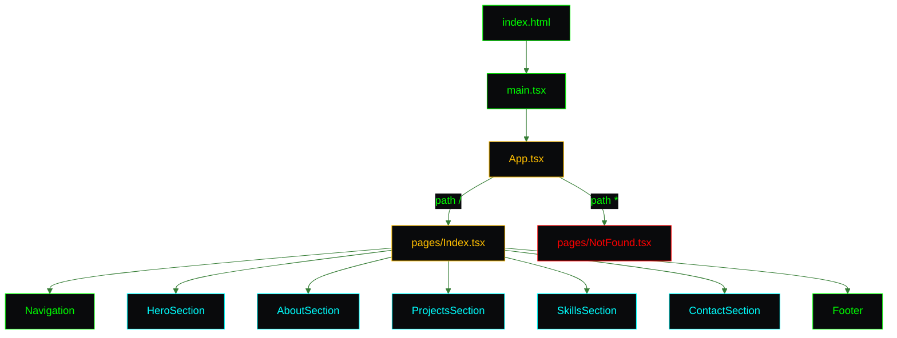

<picture>
  <source media="(prefers-color-scheme: dark)" srcset="assets/brand/header-strip-dark.svg">
  
</picture>

# Architecture

The portfolio is a frontend and nothing else: no backend, no API, no data fetching, no state library. Every word on the page is a literal in a component, and the only moving parts are a router, a handful of scroll listeners and a typing effect.

## The big picture

The same system seen from the outside, in the colours of the site: how a build becomes a container, how the container meets the internet and what the pipelines around it do.

<picture>
  <source media="(prefers-color-scheme: dark)" srcset="assets/diagrams/architecture-dark.svg">
  
</picture>

## Entry points and routing

`index.html` holds `
` and loads `src/main.tsx` as a module. `main.tsx` renders `<App />` and imports `index.css`. `App.tsx` wraps a `BrowserRouter` from `react-router` around one `Suspense` and a `Routes` with two routes, both loaded with `lazy()`. The fallback while a chunk loads is a full-height `Loading...` in the primary colour.

| Path | Component | Notes |
|---|---|---|
| `/` | `pages/Index.tsx` | The whole site. Sections are anchors (`#home`, `#about`, `#projects`, `#skills`, `#contact`), not routes |
| `*` | `pages/NotFound.tsx` | A shell-style 404 with a router link back home. It sets and restores `document.title` |

A deep link such as `/some/path` needs a server that falls back to `index.html`. nginx does it with `try_files $uri $uri/ /index.html`, and `vite dev` and `vite preview` do it by default.

## The page

`Index.tsx` renders a `div` with the `scanlines` overlay. Inside it, in order: the fixed `Navigation`, a `main` with `HeroSection`, `AboutSection`, `ProjectsSection`, `SkillsSection` and `ContactSection`, then the `Footer`.

| Component | Role | Notes |
|---|---|---|
| `Navigation` | Fixed bar with the brand mark, desktop links and a mobile menu | One passive scroll listener drives the scroll-spy and the blurred background. Below the `md` breakpoint a `$ menu` button (`aria-expanded`, `aria-controls`) opens the list. Escape, an outside click, a link click or growing past `md` closes it |
| `HeroSection` | Photo, `$ whoami`, the typed name, the typed subtitle, then the links | The links appear only after the subtitle finishes typing |
| `AboutSection` | The bio as a fake vim buffer inside a `TerminalWindow` | Line numbers are literals |
| `ProjectsSection` | An `ls -la ~/projects` table of repository links | Data lives in a `projects` array |
| `SkillsSection` | A `tree ~/skills` grid of eight groups | Data lives in a `skillCategories` array |
| `ContactSection` | A `./contact --help` window with the profile links | A `mailto:` link and the location |
| `TypingText` | Types a string one character at a time | The full text is exposed to assistive technology up front. With reduced motion it shows the full text at once and never draws the cursor |
| `ParallaxSection` | A `<section>` with a scroll-driven offset and a fade-in | The offset is zero with reduced motion |
| `TerminalWindow` | Window chrome: three dots and a title | |
| `BrandMark` | The pixel K as an inline SVG | Decorative, so `aria-hidden` |

## Scroll behaviour

The scroll-spy finds the first section whose bounding box crosses 100 px from the top of the viewport and highlights its link. It runs once on mount, so a page opened at `/#projects` lights the right link before the first scroll. Between sections the previous link stays lit. Each `ParallaxSection` listens on its own, translating the section by a fraction of its distance to the viewport (speeds from 0.2 to 0.4) and fading it in the first time it becomes visible. Smooth scrolling for the anchors comes from `html { scroll-behavior: smooth }`, and every listener is passive and removed on unmount.

## Design tokens and effects

All styling is Tailwind CSS 4 in CSS-first mode: the tokens live in one `@theme` block in `src/index.css`, there is no `tailwind.config`, and the plugin is `@tailwindcss/vite`.

| Token | Value | Use |
|---|---|---|
| `background` | `#090a0c` | Page |
| `foreground` | `#66ff66` | Body text |
| `primary` | `#00ff00` | Phosphor green: headings, links, the K |
| `secondary` | `#ffbf00` | Amber: the `$` prompt, the underscore |
| `accent` | `#00ffff` | Cyan: comments, links, the waves |
| `destructive` | `#ff0000` | The red window dot, the Java dot |
| `muted-foreground` | `#4da64d` | Secondary text |
| `terminal-dim` | `#357d35` | The quietest green, also the diagram edges |
| `border` | `#006600` | Borders |
| `--font-mono` | JetBrains Mono, Fira Code, monospace | The only font stack, loaded from Google Fonts |

The effect classes

| Class | What it does |
|---|---|
| `.scanlines` | A pointer-transparent overlay of 2px lines at 10% black, above everything |
| `.glow-green` | A green text shadow for the brand, active links and command words |
| `.animate-pulse-glow` | A pulsing green box shadow on the hero photo |
| `.cursor-blink` | A one-second step blink for the block cursor |
| `.matrix-bg` | A vertical fade plus a faint 30px green grid behind the hero |
| `.terminal-window`, `.terminal-header`, `.terminal-dot` | The window chrome |
| `.project-card`, `.skill-tag`, `.terminal-link` | Table row, pill and link treatments |
| `.animate-fade-in-up` | The hero links entrance |

A global `prefers-reduced-motion` block switches off animations, transitions and their delays, and removes the looping cursor and bounce cues.

## Brand

The mark is a pixel K on a native 32 grid, an amber prompt underscore at the foot of its leg and two rows of cyan waves under the stem. It exists as inline SVG in `BrandMark.tsx` (using the theme colours), as the favicons and manifest icons in `public/`, and as the banners, header strips and social preview in `docs/assets/brand/`. `index.html` carries the title, description, canonical URL, `theme-color`, the icon links, the manifest and the Open Graph and Twitter tags pointing at `/social-preview.png` (1280 by 640).

## Build output

`npm run build` runs the `prebuild` hook first, which copies `docs/assets/brand/social-preview.png` into `public/` so Vite emits it at `/social-preview.png`; the copy is gitignored. Then `tsc -b` type-checks the app and the Vite config, and `vite build` bundles into `dist/` with two manual chunks: `react-vendor` (react, react-dom, react-router) and `icons` (lucide-react). The profile photo is above the 4 KB inline limit and ships as a hashed file.

## Delivery

The `Dockerfile` builds `dist/` in a Node 22 Alpine stage and serves it from `nginx:alpine`. nginx adds the security headers, per-client rate limits, the bot and probe blocks, a `/health` endpoint and the single page fallback. [ENVIRONMENT.md](ENVIRONMENT.md) has the details.

---

[Back to the README](../README.md) · Next: [Environment](ENVIRONMENT.md)
