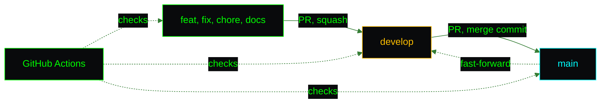

<picture>
  <source media="(prefers-color-scheme: dark)" srcset="assets/brand/header-strip-dark.svg">
  
</picture>

# CI

One workflow, three jobs, one rule: nothing reaches `main` without a green check. Lint, types, tests, a production build, a container that has to answer `/health`, and a dependency audit that also runs on a timer.

## Branch flow

Work happens on typed branches (`feat/`, `fix/`, `chore/`, `docs/`) and enters `develop` through a squash-merged pull request. `develop` is promoted to `main` with a merge commit, so both branches keep the same commits, and `develop` is fast-forwarded to `main` afterwards so the next promotion is not behind.



`main` and `develop` are protected: changes arrive through pull requests only, with the `quality` and `docker` checks green and the branch up to date, conversations resolved, no force pushes and no deletion. The `audit` job is deliberately not required, so a new upstream advisory cannot block an unrelated pull request.

## The workflow

`.github/workflows/ci.yml` runs on pull requests into `develop` and `main`, on pushes to both, every Monday at 06:17 UTC and on demand. The weekly run exists so the audit reports new advisories even when nobody pushes. It uses read-only contents permission, pins every action by commit SHA, checks out without persisting credentials and sets a timeout per job. A newer push to a pull request cancels the run in progress, while a push to a protected branch always runs to the end.

| Job | Timeout | Runs | On the weekly schedule |
|---|---|---|---|
| `quality` | 15 min | `npm ci`, `npm run lint`, `npx tsc -b`, `npm test`, `npm run build` | Skipped |
| `audit` | 10 min | `npm audit --audit-level=high` straight from the lockfile, no install | Runs |
| `docker` | 20 min | `docker build`, runs the image on port 8080 and polls `/health` up to ten times | Skipped |

> [!NOTE]
> The job names are what branch protection requires. Renaming `quality` or `docker` detaches it from the rule.

Node comes from `.nvmrc` through `setup-node`, so CI, the Dockerfile and local development agree on Node 22.

## Reproduce it locally

```bash
npm ci
npm run lint
npx tsc -b
npm test
npm run build
npm audit --audit-level=high
docker build -t portfolio-ci .
```

## The audit

`npm audit --audit-level=high` fails on any high or critical advisory, development dependencies included, and also fails when the registry cannot be reached, so an unreadable audit is never a pass. Advisories are published independently of the code, which means the check can turn red with no change in the repository. The target is zero, and the weekly run is how it gets noticed.

## Deployment

Nothing deploys automatically. The image is built from the `Dockerfile` on the host and attached to the nginx-proxy-manager network, as described in [ENVIRONMENT.md](ENVIRONMENT.md).

---

[Back to the README](../README.md) · Previous: [Testing](TESTING.md) · Next: [Roadmap](ROADMAP.md)
