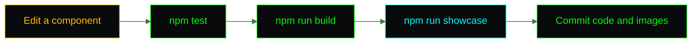

<picture>
  <source media="(prefers-color-scheme: dark)" srcset="assets/brand/header-strip-dark.svg">
  
</picture>

# Customization

There is no CMS, no config file and no database: the content is typed straight into the components, so changing the site means editing a `.tsx` file. This page says which one, and how to retake the screenshots afterwards.



## Where each thing lives

| To change | Edit | Shape |
|---|---|---|
| Name, subtitle, location, hero links | `src/components/HeroSection.tsx` | JSX literals. The typed strings are the `text` props of `TypingText` |
| The bio | `src/components/AboutSection.tsx` | One `div` per vim line with a hard-coded line number |
| Projects | `src/components/ProjectsSection.tsx` | The `projects` array at the top of the file |
| Skills | `src/components/SkillsSection.tsx` | The `skillCategories` array at the top of the file |
| Contact links | `src/components/ContactSection.tsx` | JSX literals |
| Footer credit | `src/components/Footer.tsx` | A JSX literal |
| Title, description, social tags | `index.html` and `public/site.webmanifest` | Keep the role and description in sync in both |
| Photo | `src/assets/profile-photo.webp` | Replace the file, keep the name |
| Colours and fonts | `src/index.css` | The `@theme` block |

### Add a project

Add an object to the `projects` array. `languageColor` is a full Tailwind class name (`bg-secondary`, `bg-accent` or `bg-destructive`), written out in full so the Tailwind scanner finds it.

```ts
{
  name: 'my-repo',
  description: 'One sentence that says what it does',
  language: 'TypeScript',
  languageColor: 'bg-accent',
  url: 'https://github.com/kfeuerschvenger/my-repo',
}
```

### Add a skill or a group

Add a string to a group's `skills` array, or a new `{ category, skills }` object to `skillCategories`. The tree glyphs are picked by index, so the last entry gets the closing corner automatically.

### Edit the About text

Each line of the vim window is its own `div` with a number in front. Adding a line means renumbering the ones below it by hand. A test asserts the rendered text of the dense lines, so a stray JSX whitespace shows up as a failure.

> [!NOTE]
> Content is checked by the tests, so a rename can break one. Run `npm test` after editing and update the matching `*.test.tsx` expectation together with the text.

### Add a section

Create the component, wrap it in `ParallaxSection` with an `id`, add it to `src/pages/Index.tsx` and add a `{ label, href }` entry to `navItems` in `Navigation.tsx`. The `id` must match the `href` without the hash for the scroll-spy to find it. Keep the heading in the shell pattern: an amber `$`, a muted command and a green argument.

## The brand

| Asset | Where | Used by |
|---|---|---|
| Mark, mono and colour | `docs/assets/brand/mark-*.svg` | Docs and anything that needs the bare mark |
| Lockups and banners | `docs/assets/brand/lockup-*.svg`, `banner-*.svg` | The README |
| Header strips | `docs/assets/brand/header-strip-*.svg` | The top of every deep doc |
| Social preview | `docs/assets/brand/social-preview.png` | Copied to `public/` by `predev` and `prebuild`, referenced by `og:image` and `twitter:image` |
| Favicons and icons | `public/` | `index.html` and the manifest |
| In-app mark | `src/components/BrandMark.tsx` | The navigation bar |

The mark is drawn on a 32 pixel grid, so keep any edit on whole cells to keep the edges crisp. The brand files are not covered by the MIT license, see the [LICENSE](../LICENSE).

## Retaking the screenshots

The images in the README are produced by a script, not by hand, so they can be retaken after every change. The pipeline lives in `e2e/showcase/` with its own `package.json`, so Playwright never becomes a dependency of the app.

```bash
npm --prefix e2e/showcase ci
npm --prefix e2e/showcase run install:browsers
npm run showcase
```

`npm run showcase` builds the app, serves the build on a free port, captures every still twice (raw and inside a browser frame) at 1600 by 1000 and 2x, records the hero flow in full Chromium and converts it with ffmpeg into `hero.gif` and `hero.mp4`. It prints `OK` or `FAIL` per shot and exits non-zero if any failed.

| Need | How |
|---|---|
| ffmpeg is installed but not on the PATH | Set `FFMPEG` to the executable |
| Capture a running page instead of building | Set `SHOWCASE_URL`, for example `http://localhost:5173` |
| Retake one shot | Run `capture.mjs` from `e2e/showcase/` with `SLUGS=skills`, or pass the slug as an argument |
| Write somewhere else | Set `SHOWCASE_OUT`, the same value for `capture.mjs` and `gif.mjs` |
| A new section or page | Add an entry to `SHOTS` in `capture.mjs`: a slug and a function that brings the page to the state to photograph |

<details>
<summary>The shots</summary>

| Slug | Shows |
|---|---|
| `hero` | The name and subtitle fully typed, the location and links |
| `about` | The vim window |
| `projects` | The projects table |
| `skills` | All eight groups in one tall shot |
| `contact` | The contact window and the footer |
| `not-found` | The 404 page on an unknown route |
| `mobile` | A 390 by 844 phone with the menu open |
| `mobile-hero` | The same phone on the hero, menu closed |
| `hero-video` | Page load with the hero typing, then a smooth scroll through About, Projects and Skills |

</details>

Every shot fails instead of being committed when its key text is missing or the font did not load, which is why the pipeline needs internet access. The GIF has an 8 MB budget, so keep the recorded flow short. The full reference, including how each shot is kept deterministic, is in `e2e/showcase/README.md`.

---

[Back to the README](../README.md) · Previous: [Environment](ENVIRONMENT.md) · Next: [Testing](TESTING.md)
