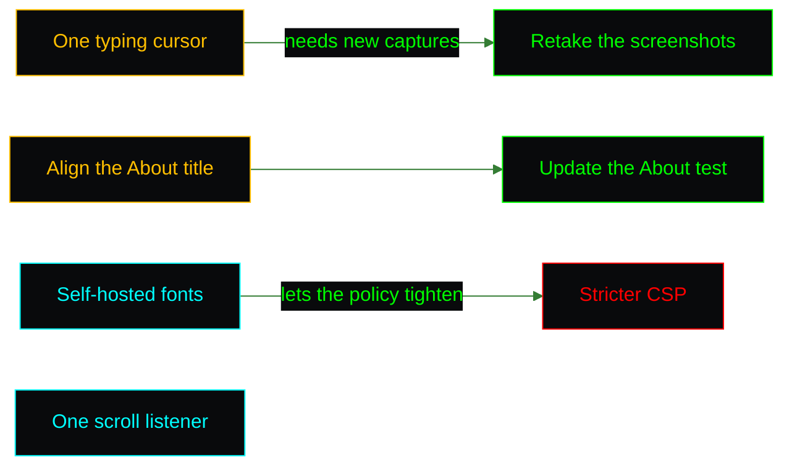

<picture>
  <source media="(prefers-color-scheme: dark)" srcset="assets/brand/header-strip-dark.svg">
  
</picture>

# Roadmap

The backlog of a site that is never quite finished: small, honest items that were noticed and not yet done. Nothing here is promised or scheduled, and each entry says what it would change and what it needs.

| Idea | In one line |
|---|---|
| [A single typing cursor](#a-single-typing-cursor) | The hero shows one block cursor, on the line being typed |
| [One title everywhere](#one-title-everywhere) | The About text says Software Engineer like the rest of the site |
| [Self-hosted fonts](#self-hosted-fonts) | No third-party request on first paint |
| [One scroll listener](#one-scroll-listener) | Share a single observer between the sections |
| [Contact still polish](#contact-still-polish) | A clean top edge on the contact screenshot |
| [Sturdier capture scripts](#sturdier-capture-scripts) | Cleanup that survives every failure path |
| [Stricter entrypoint check](#stricter-entrypoint-check) | Reject IPv4 octets with leading zeros |

## A single typing cursor

A finished typing line keeps its block cursor, so once the subtitle starts the hero shows two cursors at once. The fix is to hide a line's cursor when the next one starts, for example a `showCursor` prop that `HeroSection` passes only to the active line. It needs the hero and mobile screenshots retaken afterwards.

## One title everywhere

The hero, the page title and the metadata say Software Engineer while the About text still opens with Full Stack Developer. Aligning them is a text change in `AboutSection.tsx` and the matching expectation in its test.

## Self-hosted fonts

JetBrains Mono and Fira Code come from Google Fonts at runtime. Bundling them would remove the third-party request, work offline, and let the Content Security Policy go back to `'self'` for styles and fonts. It needs the font files in the repository and the `@import` replaced by `@font-face` rules.

## One scroll listener

Navigation and every `ParallaxSection` register their own scroll listener, and each one reads a bounding box and sets state on every event. It works, but a shared observer would do the same job with far fewer re-renders. It needs care to keep the parallax offsets identical.

## Contact still polish

The contact screenshot shows a faint strip of the skills section under the navigation bar. Scrolling so the section starts below the bar, or cropping, fixes it in `e2e/showcase/capture.mjs`.

## Sturdier capture scripts

A few cleanup paths in the capture pipeline are still optimistic: a failed copy can leave a temporary file behind on Windows, the process kill flag is set before the kill succeeds, the GIF cleanup runs only through the normal failure path, and `SLUGS` has no effect on `showcase:all`. Each is a small change in `capture.mjs`, `gif.mjs` or `run-all.mjs`, using `Promise.allSettled`, a `try` and `finally`, and a documented variable. In the same spirit, `scripts/copy-social-preview.mjs` fails with a raw stack trace when its source is missing, where one line naming the path would do.

## Stricter entrypoint check

`docker/18-check-trusted-proxy.sh` validates IPv4 prefixes strictly but accepts octets with leading zeros. Requiring each octet to match `0` or a number without a leading zero closes the gap.

---

[Back to the README](../README.md) · Previous: [CI](CI.md)
