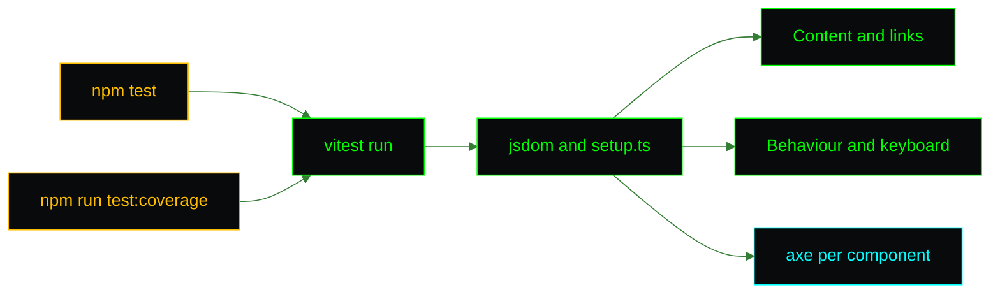

<picture>
  <source media="(prefers-color-scheme: dark)" srcset="assets/brand/header-strip-dark.svg">
  
</picture>

# Testing

Exit code 0 or it did not happen. The suite is Vitest on jsdom with React Testing Library, user-event and vitest-axe: 43 tests in 10 files, one file per component, and an accessibility scan next to the content checks.



## Running it

```bash
npm test
npm run test:coverage
```

Coverage uses v8 over `src/`, excluding the tests, the test helpers and `main.tsx`. There is no coverage threshold gate.

## Layout

| File | Role |
|---|---|
| `vitest.config.ts` | Separate from `vite.config.ts`, so the Tailwind plugin stays out of the run. jsdom, `css: false`, v8 coverage |
| `src/test/setup.ts` | Registers the jest-dom and vitest-axe matchers, installs the `matchMedia` stub before each test and cleans up after |
| `src/test/matchMedia.ts` | `installMatchMedia(initial)`: jsdom has no `matchMedia`. It answers every query with one boolean and returns a `set(next)` that fires change listeners |
| `src/test/axe.ts` | `axe` with `color-contrast` off, since jsdom has no layout |
| `src/components/*.test.tsx`, `src/pages/NotFound.test.tsx` | One file per component or page |

## What is covered

| Area | Checks |
|---|---|
| Hero | The name, then the subtitle, then the links, typed with fake timers advanced in small steps. The name does not restart when the subtitle mounts |
| TypingText | One character at a time and a single completion. A new callback identity does not restart typing. The full text is exposed to assistive technology while the animation is `aria-hidden`. With reduced motion the text is whole at once and no cursor is drawn |
| Navigation | Every section is linked from the desktop bar and the mobile menu. The scroll-spy highlights the right section on mount and after a scroll. The brand mark is decorative |
| Mobile menu | Closed by default and wired with `aria-expanded` and `aria-controls`. Opens by pointer and keyboard. Closes on Escape with focus returned, on a link click, on an outside click and when the viewport reaches `md`. Stays open on a click inside. Removes its listener on unmount |
| ParallaxSection | Moves on scroll when motion is allowed, stays at 0 with reduced motion, and nothing crashes without `matchMedia` |
| About, Projects, Skills, Contact, Footer | The content and every link, including the eight skill groups. About asserts the rendered text so a lost JSX space fails |
| NotFound | Shows the path and a link home, and sets and restores the document title |
| Accessibility | Every component runs through axe, the mobile menu while open |

## Gotchas

| Concern | Detail |
|---|---|
| Fake timers and axe | axe uses real timers. Call `vi.useRealTimers()` before awaiting it |
| `act` | Import it from `@testing-library/react`, not `react`, or the environment flag is not set and state updates are dropped |
| Chained effects | A single large `advanceTimersByTime` skips effects that need a render in between. Advance in small steps |
| `matchMedia` | Missing in jsdom. The global setup installs a stub. A test that needs `true` calls `installMatchMedia(true)` before rendering |
| Contrast | Not checked in jsdom. Verify against the palette or in a browser |
| Layout | jsdom returns zeros for every rectangle, so `ParallaxSection` stays at opacity 0 while its content is still in the DOM and queryable |

## Before opening a pull request

```bash
npm run lint
npx tsc -b
npm test
npm run build
npm audit
```

These are the same steps the [CI](CI.md) runs. The container itself is exercised by the `docker` job, which builds the image and polls `/health`. The screenshots have their own pipeline, see [CUSTOMIZATION.md](CUSTOMIZATION.md#retaking-the-screenshots).

---

[Back to the README](../README.md) · Previous: [Customization](CUSTOMIZATION.md) · Next: [CI](CI.md)
