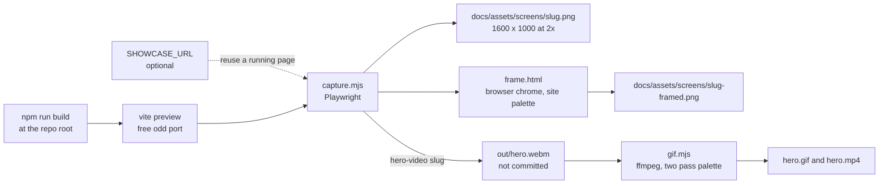

# Showcase captures

The screenshots and the animation in the repository README are produced by a script, not by hand, so they can be retaken after every change. The portfolio is static and has no demo data: `capture.mjs` builds the app, serves the build, drives it with a real browser and writes each shot twice, raw and inside a browser frame. `gif.mjs` turns the recorded hero flow into a GIF and an MP4.

This folder has its own `package.json`, so Playwright is not a dependency of the app and the app's install and CI stay lean.



## Requirements

- Node 22 or later, and the app's own dependencies installed at the repo root (`npm ci`), because the capture builds and previews the app.
- Playwright and its Chromium, from this folder: `npm ci` and `npm run install:browsers`. Playwright is pinned to the exact version in the lockfile. The hero is recorded in the full Chromium build, which this install provides.
- Internet access, because the site loads JetBrains Mono from Google Fonts. A shot fails when the font did not load.
- ffmpeg for the GIF and the MP4. Set `FFMPEG` to the executable when it is installed but not on the PATH.

## Running it

From this folder:

```bash
npm run showcase           # every still
npm run showcase:hero      # record the hero flow, then convert it
npm run showcase:all       # stills and recording in one run, then convert
```

`showcase:all` runs `run-all.mjs`, which calls `capture.mjs` once with the slug `all`, so there is one build and one preview server for the stills and the recording. It then runs `gif.mjs` whenever `out/hero.json` was written during that run, even if a still failed, and exits non-zero when any step failed. From the repo root, `npm run showcase` runs the same thing.

When running the commands by hand, `SHOWCASE_OUT` must be set to the same folder for both `capture.mjs` and `gif.mjs`, or the GIF and the MP4 are published somewhere other than the shots.

When ffmpeg is installed but not on the PATH, find it and point `FFMPEG` at it. In PowerShell:

```powershell
(Get-Command ffmpeg).Source
$env:FFMPEG = "C:\path\to\ffmpeg.exe"
```

In Git Bash, `where ffmpeg` or `command -v ffmpeg` prints the path. The winget build lives under `%LOCALAPPDATA%\Microsoft\WinGet\Packages\Gyan.FFmpeg_*\ffmpeg-*\bin`, and the version folder name changes with each release, so list that folder instead of copying a path.

| Variable | Default | Meaning |
|---|---|---|
| `SHOWCASE_URL` | Builds and serves the app | A running page to capture instead, for example `http://localhost:5173`. Nothing is built or started |
| `SLUGS` | Every still | A comma separated list of slugs, or `all` for the stills and the recording. A slug may also be passed as an argument |
| `SHOWCASE_OUT` | `docs/assets/screens` | Where the shots and the animation are published |
| `SHOWCASE_FRAME_SCALE` | `1.25` | The pixel density of the framed shots. Must be a finite number above 0, empty means the default |
| `FFMPEG` | `ffmpeg` | The ffmpeg executable |

The script prints `OK` or `FAIL` for each shot and exits non-zero at the end when any failed. A failing still does not stop the other shots or the recording.

The preview server is stopped at the end, also when a shot fails. It is also stopped on Ctrl+C and on SIGTERM, and on any exit of the process: on Windows the process tree is killed with `taskkill /T /F`. A hard kill of node itself (for example `taskkill /F` on the capture process) cannot run any handler and can leave the server listening.

Outputs are staged. Stills are written to `out/stills/`, copied to `<name>.tmp` in the output folder, and renamed into place only after both the raw and the framed copy succeeded. `gif.mjs` encodes the GIF and the MP4 to temporary files in `out/`, removes them on success and on failure, and publishes with the same copy-then-rename step only when the GIF fits the 8 MB budget, so a failed encode leaves the committed assets untouched. The rename is not a transaction across files: a crash between the two renames can leave one new file beside one old one. The recording step deletes the previous `out/hero.webm` and `out/hero.json` first, and `gif.mjs` refuses to run when `hero.json` is missing, older than `hero.webm`, or does not hold finite `start` and `end` values with `end` greater than `start`.

## The shots

| Slug | Shows | Output |
|---|---|---|
| `hero` | The name and subtitle fully typed, the location and the links | `hero.png`, `hero-framed.png` |
| `about` | The about.txt window | `about.png`, `about-framed.png` |
| `projects` | The projects table | `projects.png`, `projects-framed.png` |
| `skills` | The eight skill groups in one tall shot (1600 x 1900) | `skills.png`, `skills-framed.png` |
| `contact` | The contact window and the footer | `contact.png`, `contact-framed.png` |
| `not-found` | The 404 page for a random unknown route, shown in the address bar | `not-found.png`, `not-found-framed.png` |
| `mobile` | A 390 x 844 phone at 3x with the mobile menu open | `mobile.png`, `mobile-framed.png` |
| `mobile-hero` | The same phone on the hero, menu closed | `mobile-hero.png`, `mobile-hero-framed.png` |
| `hero-video` | Page load with the hero typing, then a smooth scroll through About, Projects and Skills | `hero.gif`, `hero.mp4` |

The recording has its own slug, `hero-video`, because `hero` is the still. Stills are 1600 x 1000 at 2x unless the table says otherwise. Raw files are the screenshot as taken; framed files put it in the browser window rendered from `frame.html`.

## How the shots stay the same

- Each still opens a fresh browser context, so nothing carries over from one shot to the next.
- Before a shot the script waits for the hero typing to finish, for `document.fonts.ready`, for the scroll position to stop, and for every finite animation and transition to end. It then asserts that the key text is visible (the name, `ai/`, the 404 message), so a broken render fails instead of being committed.
- Sections are reached with an instant jump and not a smooth scroll, because the parallax offsets follow the scroll position and must be at rest.
- The pointer is parked in a corner so no link shows a hover state.
- The hero is recorded in the full Chromium build (`channel: 'chromium'`) at a pixel density of 1. The default headless shell rasterizes in software and stutters on scrolling. The page is loaded once before the take so the fonts are cached, and `gif.mjs` trims that warm up.
- The MP4 is encoded at 25 fps, 1440 px wide, H.264, `yuv420p` with faststart. The GIF is 20 fps at 1100 px wide and must stay under 8 MB. Every frame of a scroll changes the whole picture, so the flow is kept short, and `gif.mjs` snaps colour channels to coarse steps before building the palette, which hides the codec noise of the recording. When an encode is over budget it retries with a coarser setting.

## Measuring smoothness

Count the distinct frames of the MP4 with `ffmpeg -i hero.mp4 -vf mpdecimate,showinfo -f null -` and look for at least 20 per second while the page scrolls. Frame counts do not prove it looks right, so watch the animation too.

## Retaking after a feature

1. Rerun `npm run showcase` at the close of each change that alters a section, and commit the images with the change.
2. A new section or page is one more entry in `SHOTS` in `capture.mjs`: a slug, a function that brings the page to the state to photograph, and an optional `viewport`, `mobile` flag or address for the frame.
3. A change to the hero flow is the `recordHero` function. Keep it short: lengthening it pushes the GIF past its budget.
4. The frame is `frame.html`: the window, the dots, the address bar and the background are plain CSS in the site palette.
